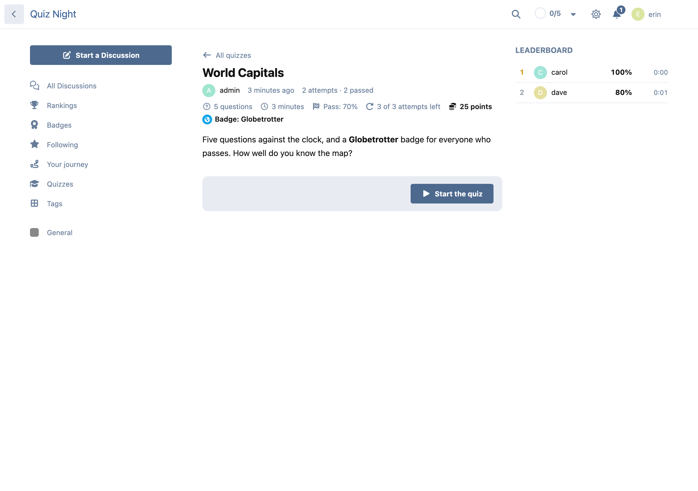
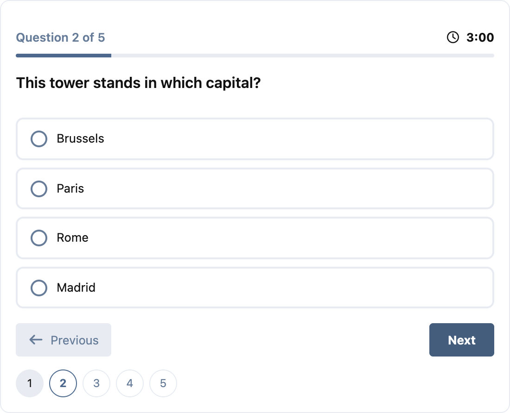
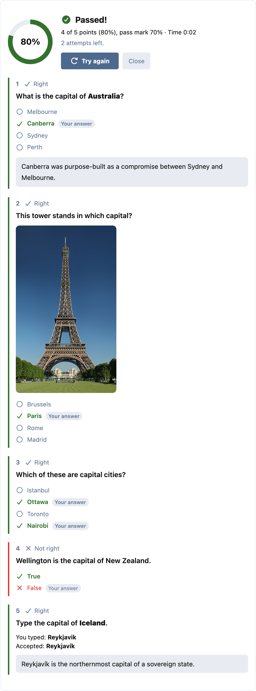
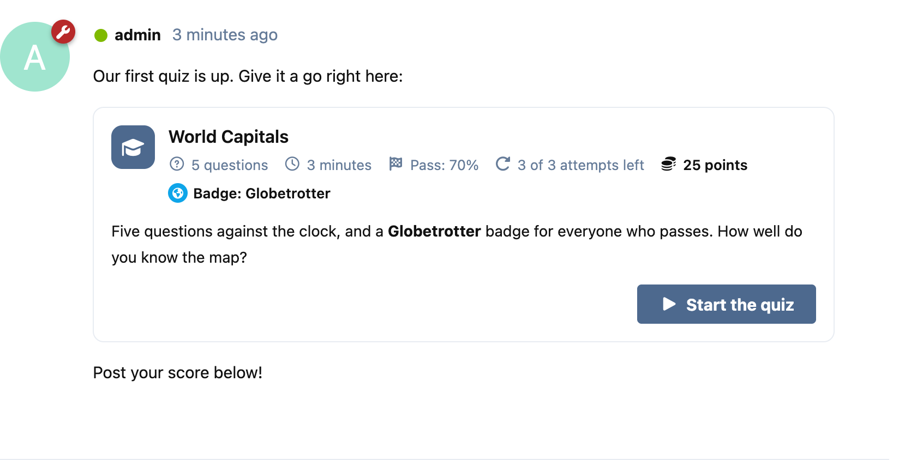
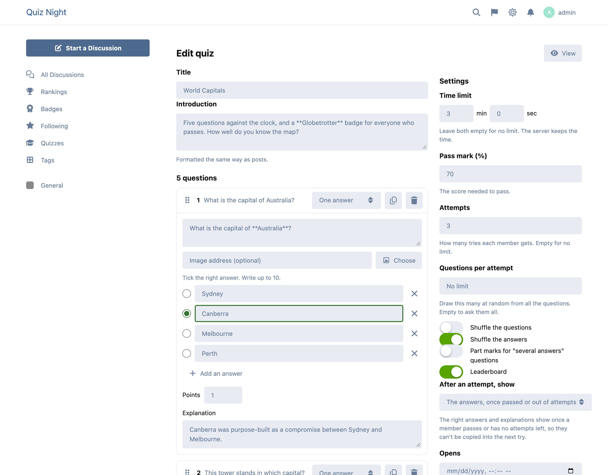
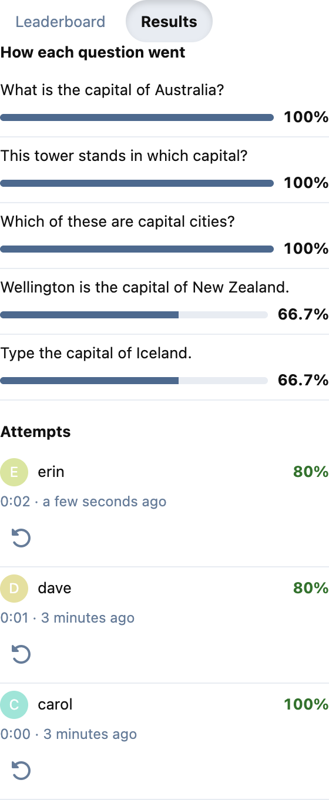
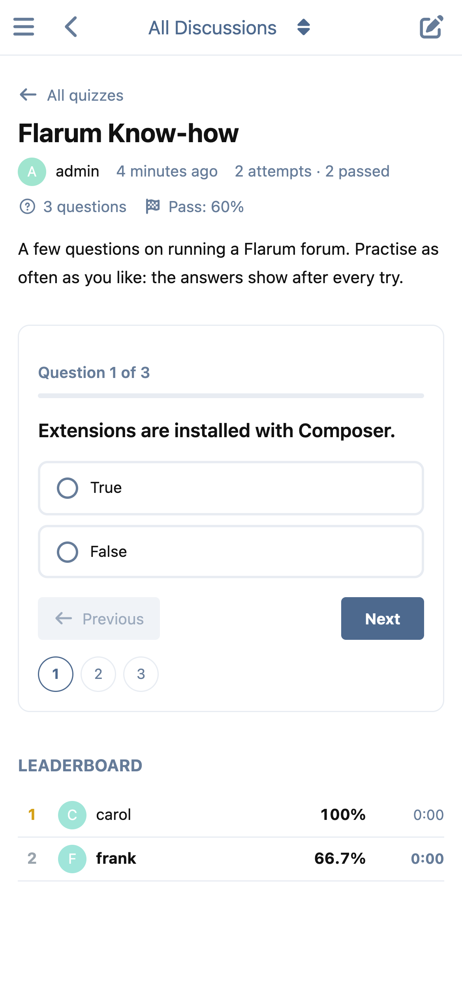

# Brainstorm — quizzes for Flarum

 

Quizzes and knowledge tests for your community. Write a quiz once, play it on its own page or right inside a discussion, and reward the members who pass it.



## Features

- **Four kinds of question:** one right answer, several right answers, true or false, and typed answers (matched without fussing over case, accents, spacing or surrounding punctuation). Any question can carry an image and an explanation.
- **Marked on the server.** The answer key never reaches a player's browser before the attempt is marked, so it can't be read from the page or the network tab.
- **Timed quizzes** with a countdown. The server keeps the time: a late submission is refused, and an attempt left running is marked on what was saved before the deadline.
- **Pass marks, attempt limits and opening and closing dates.** Draw a set number of questions at random from a bigger pool, shuffle the questions and the answers, and give part marks for "several answers" questions if you want.
- **You choose what players see afterwards:** the score only, which questions were right, or the right answers. The right answers can wait until a member has passed or used up their attempts, so they can't be copied into the next try.
- **Leaderboards** for each quiz and across all quizzes. Members can keep themselves off every leaderboard from their settings.
- **Quizzes inside posts.** Put a quiz's link on a line of its own, or use the composer's **Quiz** button, and the post shows the quiz itself, ready to play. This works with Markdown, BBCode, Scribe and FoF Rich Text.
- **Rewards:** a [FoF Badges](https://github.com/FriendsOfFlarum/badges) badge and [FoF Gamification](https://github.com/FriendsOfFlarum/gamification) points for passing a quiz the first time. FoF Badges also gets two triggers: *quizzes passed* and *quizzes finished with 100%*.
- **Assessments:** group existing quizzes (one per chapter, say) under one overall result. Each quiz stays its own quiz; the overall result is the equal or weighted average of a member's best score at each, with its own passing score and a combined progress ring. An assessment is complete once every required quiz is finished and the average reaches the passing score.
- **Course-only quizzes** with [Syllabus](https://github.com/ernestdefoe/syllabus): limit a quiz to members enrolled in one of your courses. Its instructors and course managers see it too; nobody else does, on any list, leaderboard or embed.
- **Onramp:** a "pass N quizzes" step for the [Onramp](https://github.com/ernestdefoe/onramp) onboarding checklist.
- **Results for authors:** every finished attempt, how often each question is answered correctly, and a reset for any member's attempts.
- **Practice runs:** authors and moderators can try any quiz, drafts included. Those runs never appear on leaderboards and never earn rewards.
- **A widget** showing the top quiz takers or the newest quizzes, for [Bespoke](https://ernestdefoe.online), [FoF Forum Widgets](https://github.com/FriendsOfFlarum/forum-widgets-core) and Page Builder. In FoF Forum Widgets, drag it into a section of the layout editor; it shows nowhere until you do.
- Translatable throughout, works in light and dark mode, and adds about 4 KB (gzipped) to the JavaScript every page loads. Everything else loads only on the pages that use it.

## Screenshots

| Playing, against the clock | The marked attempt |
| --- | --- |
|  |  |

| A quiz inside a post | The editor |
| --- | --- |
|  |  |

| How each question went | On a phone |
| --- | --- |
|  |  |

<sub>The Eiffel Tower photo in the screenshots is by Benh LIEU SONG, [CC BY-SA 3.0](https://creativecommons.org/licenses/by-sa/3.0/), via Wikimedia Commons.</sub>

## Installation

```sh
composer require ernestdefoe/brainstorm
```

Then enable **Brainstorm** in the admin panel.

Timed attempts that a member abandons (closed the tab, lost the connection) are marked by a scheduled task every five minutes. Make sure Flarum's scheduler runs, as described in [Flarum's scheduler docs](https://docs.flarum.org/2.x/scheduler):

```sh
* * * * * cd /path/to/flarum && php flarum schedule:run >> /dev/null 2>&1
```

Without it, an abandoned attempt is still marked when its member next opens the quiz.

## Updating

```sh
composer update ernestdefoe/brainstorm
php flarum migrate
php flarum cache:clear
```

## Permissions

| Permission | Default |
| --- | --- |
| View quizzes | Everyone, guests included |
| Take quizzes | Members |
| Write quizzes | Moderators |
| Edit and delete any quiz, see every result | Moderators |
| Attach points and badges to quizzes | Admins |

Rewards have their own permission so that a quiz's author can't pay themselves for passing a quiz they wrote.

## Points

FoF Gamification recounts a member's points from their votes, so points granted by another extension need its point-grants feature. Until your FoF Gamification version has it, the points field stays hidden; badges work either way.

## For extension developers

Listen with `Extend\Event` inside `Extend\Conditional()->whenExtensionEnabled('ernestdefoe-brainstorm', …)`:

| Event | Properties | When |
| --- | --- | --- |
| `ErnestDefoe\Brainstorm\Event\AttemptFinished` | `Attempt $attempt`, `User $user`, `bool $firstPass` | A counted attempt was marked (practice runs never fire it). `$firstPass` is true the one time a member first passes that quiz. |
| `ErnestDefoe\Brainstorm\Event\AssessmentCompleted` | `Assessment $assessment`, `User $user`, `float $percent` | A member completed an assessment: every required quiz finished and the average reached its passing score. Once per member and assessment, ever. |

`ErnestDefoe\Brainstorm\OptOut::userIds()` is a subquery of the members who keep themselves off quiz leaderboards, for `whereNotIn('users.id', …)`.

## Links

- [Source code on GitHub](https://github.com/ernestdefoe/brainstorm)
- [Report an issue](https://github.com/ernestdefoe/brainstorm/issues)
- ☕ [Buy me a coffee](https://buymeacoffee.com/ernestdefoe)
